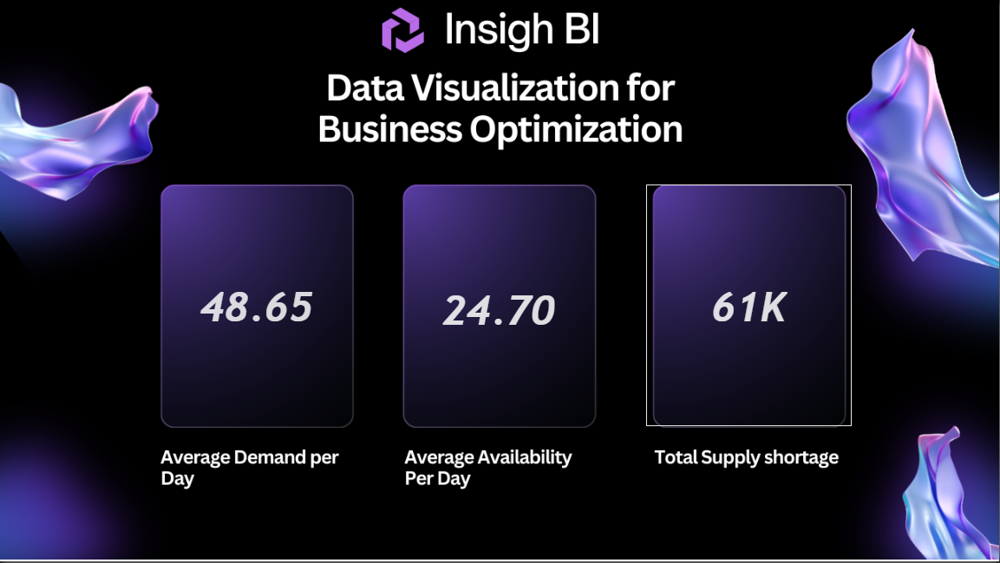
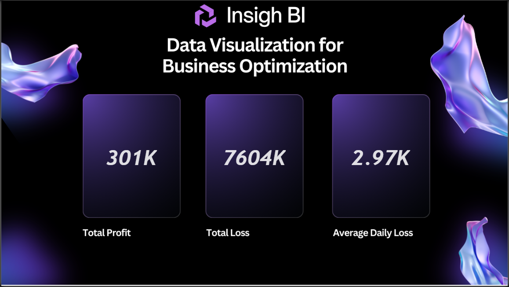
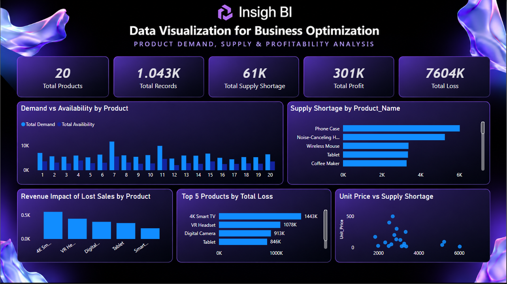

# Demand, Supply & Profitability Analysis | Power BI

Power BI analysis of product demand, supply shortages, profitability, and the financial impact of lost sales across a portfolio of 20 products.

## Dashboard Preview

### Demand & Supply Overview



### Profitability & Loss



### Product Demand, Supply & Profitability



---

## Business Problem

Businesses need to balance customer demand with product availability while understanding how supply shortages affect financial performance.

This project analyzes product-level demand, availability, supply shortages, profit, and losses to identify where operational shortages may be creating the greatest financial impact.

The analysis is designed to answer questions such as:

- How does product demand compare with available supply?
- Which products experience the greatest supply shortages?
- Which products contribute most to financial losses?
- What is the revenue impact of lost sales?
- How does unit price relate to supply shortages?
- Which products should receive greater attention from an operational and financial perspective?

---

## Objectives

- Analyze demand and product availability.
- Quantify supply shortages across products.
- Measure profitability and losses.
- Identify products with the greatest financial impact from lost sales.
- Compare unit prices with supply shortages.
- Create an interactive Power BI dashboard for operational and financial decision-making.

---

## Dataset

The project contains three datasets:

| Dataset | Records | Description |
|---|---:|---|
| Production Environment | 1,043 | Main demand and availability dataset |
| Test Environment | 99 | Test/validation dataset |
| Products | 20 | Product master data containing product names and unit prices |

### Production Data Fields

- Order Date
- Product ID
- Availability
- Demand

### Product Data Fields

- Product ID
- Product Name
- Unit Price

---

## Key Findings

### Supply does not consistently meet demand

The production dataset contains **1,043 observations** across 20 products. Average observed demand is substantially higher than average product availability, resulting in a significant supply shortage.

### Supply shortages are concentrated among specific products

Products such as the **Phone Case, Noise-Cancelling Headphones, Wireless Mouse, Tablet, and Coffee Maker** appear among the products with substantial recorded shortages.

### High-value products can create greater financial impact

Products including the **4K Smart TV, VR Headset, Digital Camera, and Tablet** contribute significantly to the total loss associated with lost sales.

This demonstrates why shortage analysis should consider both **volume and unit price**, rather than focusing only on the number of units unavailable.

### Lost sales create measurable financial impact

The profitability analysis connects supply shortages to financial outcomes, allowing products to be prioritized based on their potential revenue and loss impact.

> These findings describe patterns observed in the dataset and should not be interpreted as evidence of causation.

---

## Power BI Dashboard

### Page 1 — Demand & Supply Overview

Provides a high-level view of the relationship between customer demand and available supply.

Key metrics include:

- Average Demand per Day
- Average Availability per Day
- Total Supply Shortage

This page establishes the operational picture and highlights the gap between demand and supply.

### Page 2 — Profitability & Loss

Focuses on the financial consequences of supply and sales performance.

Key metrics include:

- Total Profit
- Total Loss
- Average Daily Loss

This page connects operational performance with financial outcomes.

### Page 3 — Product Demand, Supply & Profitability

Provides detailed product-level analysis through:

- Demand vs Availability by Product
- Supply Shortage by Product
- Revenue Impact of Lost Sales
- Top 5 Products by Total Loss
- Unit Price vs Supply Shortage

This page helps identify products where supply constraints may have the greatest operational or financial significance.

---

## Business Insights

The analysis suggests several areas where management attention could be valuable:

1. **Prioritize products with persistent supply shortages**  
   Products with consistently high unmet demand may require inventory or replenishment review.

2. **Consider financial impact when prioritizing inventory**  
   High-priced products with shortages can have a greater revenue impact than lower-priced products with similar shortage volumes.

3. **Monitor demand and availability together**  
   Tracking both metrics provides better visibility into whether operational capacity is keeping pace with customer demand.

4. **Investigate products with high loss contribution**  
   Products responsible for a large share of total losses can be prioritized for deeper operational investigation.

5. **Use product-level analysis for inventory decisions**  
   Aggregate supply metrics can hide product-specific problems. Product-level analysis provides a more actionable view.

---

## Tools & Skills

### Power BI
- Data modeling
- DAX measures
- KPI development
- Interactive dashboards
- Data visualization
- Business analysis
- Product-level performance analysis

### Data Analysis
- Demand and supply analysis
- Shortage analysis
- Profitability analysis
- Lost-sales analysis
- Product segmentation
- Operational performance analysis

### Data Preparation
- CSV data ingestion
- Production/test dataset separation
- Product lookup integration
- Data validation

---

## Project Structure

```text
demand-supply-profitability-analysis/
│
├── README.md
├── .gitignore
│
├── data/
│   ├── Prod_Env_Data.csv
│   ├── Test_Env_Data.csv
│   └── Products.csv
│
├── powerbi/
│   └── Demand_Supply_Profitability.pbix
│
└── screenshots/
    ├── demand-supply-overview.png
    ├── profitability-loss.png
    └── product-profitability-analysis.png
```

---

## Key Takeaway

This project demonstrates how Power BI can connect **operational metrics with financial outcomes**.

Rather than analyzing demand, availability, and profitability independently, the dashboard links them together to identify where supply shortages may be creating the greatest business impact.

---

## Disclaimer

This project is intended for portfolio and analytical demonstration purposes. The dataset is used to demonstrate Power BI, data analysis, and business intelligence techniques. Findings represent patterns within the available data and should not be treated as definitive business or financial conclusions.